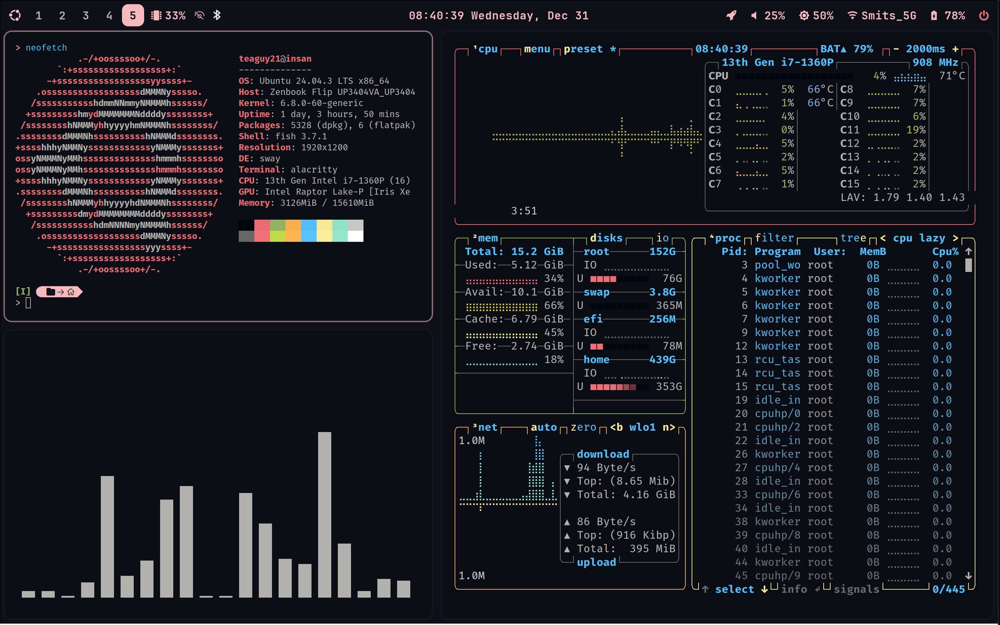

# Dotfiles

<p align="center">
  
</p>

<p align="center">
  <em>Hyprland (Lua config) and eww, with one switch for dark and light themes</em>
</p>

## Contents
- [What's here](#whats-here)
- [Requirements](#requirements)
- [Installation](#installation)
- [Theme](#theme)
- [Keybindings](#keybindings)
- [eww bar](#eww-bar)
- [Kanata](#kanata)
- [Making changes](#making-changes)
- [License](#license)
- [Credit](#credit)

## What's here

| Path | What |
| --- | --- |
| `.config/hypr` | Hyprland 0.55+ config in Lua (`hyprland.lua` loads `conf/*.lua`), hypridle, hyprlock, screenshot and recording scripts |
| `.config/eww` | Status bar (workspaces, audio, network, battery, TLP, notifications, popups) |
| `.config/theme` | Theme generator: fills templates from a palette to make each app's color file |
| `.config/swaync` | Notification center |
| `.config/wofi` | App launcher and power menu |
| `.config/swww` | Wallpaper switcher |
| `.config/alacritty`, `kitty`, `ghostty` | Terminals |
| `.config/fish` | Shell (fisher, nvm) |
| `.config/nvim` | Neovim (lazy.nvim, LSP, telescope, treesitter) |
| `.config/Google/AndroidStudio*`, `.ideavimrc` | Android Studio settings (keymap, editor, code style) and IdeaVim, mirroring the VS Code setup |
| `.config/yazi`, `zathura`, `btop` | File manager, PDF viewer, system monitor |
| `.config/kanata` | Key remapping (systemd user service) |
| `.config/scripts` | TLP profile switcher, Bluetooth auto-switch |
| `.config/gammastep` | Night light |
| `.config/systemd/user` | User services (kanata, swww, pipewire) |
| `.themes`, `.fonts`, `.poshthemes` | GTK theme (ayu-dark), fonts, oh-my-posh theme |

## Requirements

Core: `git`, `stow`, `hyprland` (0.55 or newer, for the Lua config), `eww`, `swaync`, `wofi`, `swww`, `hypridle`, `hyprlock`, `alacritty`, `fish`, `envsubst` (gettext), `jq`.

The keybindings and scripts also call `grim`, `slurp`, `wl-clipboard`, `tesseract` (OCR), `wl-color-picker`, `wl-screenrec`, `libnotify`, `pactl`/`wpctl`, `brightnessctl`, `playerctl`, `nemo`, `yazi`, `kitty`, `neovim` and `nmtui`.

Optional: `kanata`, `gammastep`, `tlp`, `kdeconnect`, `lxpolkit`, `gnome-keyring`, `ghostty`, `zathura`, `btop`, `oh-my-posh`, Papirus icon theme.

## Installation

```fish
git clone git@github.com:insanansharyrasul/dotfiles.git ~/.dotfiles
cd ~/.dotfiles
stow .
~/.config/theme/apply.sh dark   # REQUIRED: generates the gitignored color files
```

Then log into Hyprland.

> Run `apply.sh` before starting Hyprland for the first time. The color files, including `hypr/conf/colors.lua`, are generated and not committed, and Hyprland won't load without that one.

Some settings are specific to my machine, so check these:
- Monitors are set in `.config/hypr/monitors.lua`. Outputs not listed there fall back to `highres` at scale 2.
- The eww bar opens on `eDP-1` and `HDMI-A-1`, hardcoded in `.config/eww/scripts/launch.sh`.
- The wallpaper list is in `.config/swww/swww.sh` and expects files in `~/Pictures/Wallpapers/`.
- Autostart programs are in `.config/hypr/conf/autostart.lua`.

To start Kanata at login:
```fish
systemctl --user enable --now kanata.service
```

## Theme

Every color comes from one palette, `.config/theme/palettes/dark.scss` or `light.scss`.

```fish
~/.config/theme/apply.sh dark     # or: light
~/.config/theme/apply.sh toggle   # switch between dark and light
~/.config/theme/apply.sh          # re-apply last used mode
```

The script writes new colors for Alacritty, Kitty, Ghostty, btop, swaync, wofi, Hyprland borders, hyprlock, zathura, oh-my-posh and eww, then reloads eww, Hyprland, Kitty and swaync. Ghostty has to be reloaded by hand with `ctrl+shift+,`.

To change a color, edit the palette and run `apply.sh` again. To theme another app, add a template to `theme/templates/` that uses variables like `${accent}` and `${background}`, then add an `envsubst` line for it in `apply.sh`. Don't edit the generated files; they start with `Generated by theme/apply.sh` and get overwritten.

## Keybindings

`Super` is the main modifier. The full list is in `.config/hypr/conf/binds.lua`.

### Apps

| Key | Action |
| --- | --- |
| `Super + Return` / `Super + Q` | Terminal (Alacritty) |
| `Super + D` | App launcher (wofi) |
| `Super + E` | Firefox |
| `Super + F` / `Super + Shift + F` | Nemo / Yazi |
| `Super + N` | Neovim |
| `Super + V` | VS Code |
| `Super + T` | System monitor |
| `Super + A` | Network (nmtui) |
| `Super + W` | Notification center |
| `Super + B` | Toggle eww bar |

### Windows and workspaces

| Key | Action |
| --- | --- |
| `Super + Shift + Q` | Close window |
| `Super + H/J/K/L` (or arrows) | Move focus |
| `Super + Shift + H/J/K/L` | Move window |
| `Super + 1..0` | Go to workspace 1 to 10 |
| `Super + Shift + 1..0` | Move window to workspace |
| `Ctrl + Alt + H/L` | Previous / next workspace |
| `Super + Tab` | Cycle layout: dwindle, scrolling, monocle |
| `Super + S` | Toggle split |
| `Super + G` | Fullscreen |
| `Super + Space` | Toggle floating |
| `Super + R` | Resize mode (`hjkl` or arrows, `Esc` to exit) |
| `Super + X` / `Super + C` | Send to / toggle scratchpad |
| `Super + [` / `]` / `/` | Gaps bigger / smaller / reset |
| `Super + Shift + =` / `-` | Zoom in / out |
| `Super + LMB` / `RMB` | Drag / resize window |

### Tools and system

| Key | Action |
| --- | --- |
| `Print` | Screenshot full screen |
| `Super + Print` | Screenshot window |
| `Super + Shift + S` | Screenshot region |
| `Super + Shift + T` | OCR a region and copy the text |
| `Super + Shift + E` | Color picker |
| `Super + Shift + R` | Record screen (press again to stop) |
| `Super + Ctrl + Shift + R` | Record with desktop audio |
| `Super + Shift + A` / `G` | Record area / GIF |
| `Super + F2` / `F3` / `F4` | Volume down / up / mute |
| `Super + M` | Mic mute |
| `Super + Ctrl + L` | Lock screen |
| `Super + Shift + P` | Power menu |
| `Super + Shift + C` | Reload Hyprland |
| `Super + Shift + O` | Exit Hyprland |

## eww bar

Clicking the clock opens a calendar. Middle-click switches between the live and static wallpaper, and right-click moves to the next wallpaper.

The TLP icon opens an interactive switcher between the high and low performance profiles. The idle icon toggles the idle inhibitor.

If the bar dies, restart it with `~/.config/eww/scripts/launch.sh`.

## Kanata

| Key | Tap | Hold |
| --- | --- | --- |
| `Caps Lock` | `Esc` | `Ctrl` |
| `` ` `` | `` ` `` | Arrow layer: `hjkl` and `wasd` act as arrows |
| `Right Alt` | nothing | Mouse layer: `hjkl` move, `w`/`s` scroll, `Caps`/`` ` `` left/right click, `a` middle click, `d` speed boost |

## Making changes

The files in `~/.config` are symlinks into `~/.dotfiles`, so you can edit either path. Commit from `~/.dotfiles`.

To add a new config, put it in `~/.dotfiles/.config/<app>/` and run `stow .` again. After a `git pull`, run `stow .` again only if new files came in.

For Hyprland, add a file under `hypr/conf/` and `require` it in `hyprland.lua`. Each `require` runs in its own scope, so an error in one file won't break the others.

## License

GPL-3.0. See [LICENSE](LICENSE).

## Credit
I also used other resources for my dotfiles:
1. [Ayu-dark theme, by K4zoku](https://github.com/K4zoku/dotfiles/tree/a486fb6d612db309e0dfc9123fb2ffcf9213db21)
2. [RAM Usage Script for Eww Bar](https://github.com/insanansharyrasul/sysinfoscript)
